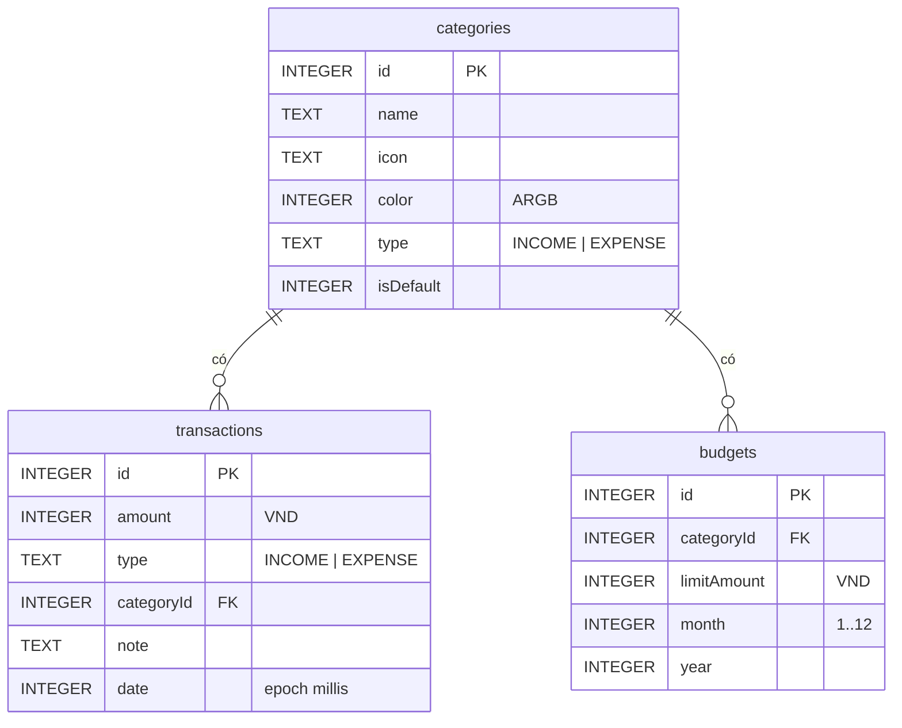

# Expense Tracker

Ứng dụng Android quản lý chi tiêu cá nhân, viết bằng Kotlin, lưu dữ liệu cục bộ bằng SQLite thông qua Room.

## 1. Tính năng

**Cốt lõi**
- Thêm / sửa / xóa giao dịch thu - chi (số tiền, danh mục, ngày, ghi chú)
- Màn tổng quan: tổng thu, tổng chi, số dư theo tháng, giao dịch gần nhất
- Danh sách giao dịch: lọc theo loại, danh mục, khoảng ngày; tìm theo ghi chú
- Quản lý danh mục (có sẵn danh mục mặc định, không cho xóa danh mục đang có giao dịch)

**Nâng cao**
- Ngân sách theo danh mục theo tháng, cảnh báo khi gần vượt hạn mức
- Báo cáo: biểu đồ chi theo danh mục, thu chi theo tháng
- Xuất CSV / sao lưu dữ liệu

## 2. Công nghệ

| Thành phần | Công nghệ |
|---|---|
| Ngôn ngữ | Kotlin |
| UI | Jetpack Compose |
| Kiến trúc | MVVM |
| Database | SQLite qua Room |
| Bất đồng bộ | Kotlin Coroutines + Flow |
| Điều hướng | Navigation Compose |
| DI | Hilt (hoặc khởi tạo thủ công) |
| Biểu đồ | Vico / MPAndroidChart |
| Build | Gradle (Kotlin DSL), KSP |

## 3. Cấu trúc dự án

```
ExpenseTracker/
├── app/
│   ├── schemas/                          # Room tự xuất schema JSON (commit lên Git)
│   └── src/main/java/com/yourname/expensetracker/
│       ├── data/
│       │   ├── local/
│       │   │   ├── AppDatabase.kt        # Khai báo DB, seed danh mục mặc định
│       │   │   ├── dao/
│       │   │   │   ├── CategoryDao.kt
│       │   │   │   ├── TransactionDao.kt
│       │   │   │   └── BudgetDao.kt
│       │   │   └── entity/
│       │   │       ├── TransactionType.kt
│       │   │       ├── CategoryEntity.kt
│       │   │       ├── TransactionEntity.kt
│       │   │       ├── BudgetEntity.kt
│       │   │       └── QueryModels.kt    # TransactionWithCategory, CategoryTotal,
│       │   │                             # MonthlyTotal, BudgetWithSpent
│       │   └── repository/
│       │       ├── CategoryRepository.kt
│       │       ├── TransactionRepository.kt
│       │       └── BudgetRepository.kt
│       ├── ui/
│       │   ├── navigation/AppNavGraph.kt
│       │   ├── theme/
│       │   ├── home/                     # HomeScreen, HomeViewModel
│       │   ├── transaction/              # Thêm/sửa/danh sách giao dịch
│       │   ├── category/                 # Quản lý danh mục
│       │   ├── budget/                   # Ngân sách
│       │   └── report/                   # Báo cáo, biểu đồ
│       ├── di/AppModule.kt
│       ├── util/
│       │   ├── CurrencyFormatter.kt
│       │   └── DateUtils.kt
│       ├── ExpenseApp.kt                 # Application class
│       └── MainActivity.kt
├── docs/                                 # Tài liệu, ảnh chụp màn hình, sơ đồ
├── gradle/
├── build.gradle.kts
├── settings.gradle.kts
└── README.md
```

## 4. Luồng dữ liệu

```
Screen (Compose) → ViewModel → Repository → DAO → SQLite
        ↑                                           |
        └────────────── Flow / StateFlow ───────────┘
```

| Lớp | Trách nhiệm |
|---|---|
| Screen | Chỉ hiển thị và nhận sự kiện người dùng |
| ViewModel | Giữ state màn hình, gọi Repository |
| Repository | Điểm truy cập dữ liệu duy nhất, UI không biết dữ liệu đến từ đâu |
| DAO | Các câu query, trả về `Flow` để UI tự cập nhật |

## 5. Thiết kế database



### Chi tiết các bảng

**categories**

| Cột | Kiểu | Ràng buộc |
|---|---|---|
| id | INTEGER | PK, tự tăng |
| name | TEXT | UNIQUE cùng với `type` |
| icon | TEXT | tên icon |
| color | INTEGER | màu ARGB |
| type | TEXT | INCOME / EXPENSE |
| isDefault | INTEGER | 1 = danh mục mặc định |

**transactions**

| Cột | Kiểu | Ràng buộc |
|---|---|---|
| id | INTEGER | PK, tự tăng |
| amount | INTEGER | số tiền VND |
| type | TEXT | INCOME / EXPENSE |
| categoryId | INTEGER | FK → categories.id, `ON DELETE RESTRICT` |
| note | TEXT | mặc định rỗng |
| date | INTEGER | epoch millis |

Index: `categoryId`, `date`.

**budgets**

| Cột | Kiểu | Ràng buộc |
|---|---|---|
| id | INTEGER | PK, tự tăng |
| categoryId | INTEGER | FK → categories.id, `ON DELETE CASCADE` |
| limitAmount | INTEGER | hạn mức VND |
| month | INTEGER | 1..12 |
| year | INTEGER | |

Unique: `(categoryId, month, year)`.

### Quy ước dữ liệu

- Tiền lưu bằng `Long` (VND), không dùng `Double` để tránh sai số.
- Ngày lưu bằng epoch millis để dễ sắp xếp và lọc theo khoảng.
- Không xóa được danh mục đang có giao dịch (RESTRICT).
- Danh mục mặc định được tạo tự động lần đầu chạy app (xem `AppDatabase.kt`).

## 6. Cài đặt và chạy

1. `git clone <repo-url>`
2. Mở bằng **Android Studio** hoặc **IntelliJ IDEA** (đã bật plugin Android).
3. Chờ Gradle sync xong.
4. Chạy trên máy ảo hoặc thiết bị thật (Android 8.0 trở lên).

Xem dữ liệu lúc chạy: **App Inspection → Database Inspector** (Android Studio).
Nếu cần dữ liệu seed chạy lại từ đầu: gỡ app khỏi máy ảo rồi chạy lại.

## 7. Quy ước làm việc nhóm

- Nhánh chính: `main`. Mỗi tính năng làm trên nhánh `feature/<tên>`, tạo Pull Request để merge.
- Mỗi người một IDE tùy thích, nhưng **không commit** `local.properties`, `.idea/`, `build/`.
- Thay đổi entity/DAO phải báo cả nhóm vì mọi màn hình phụ thuộc vào đó.
- Mỗi lần đổi cấu trúc bảng: tăng `version` trong `AppDatabase` và viết `Migration`; commit kèm file trong `app/schemas/`.
- Đặt tên: class `PascalCase`, hàm/biến `camelCase`, package chữ thường.

## 8. Lộ trình

- [x] Thiết kế database, entity, DAO
- [ ] Repository + ViewModel
- [ ] Màn thêm/sửa giao dịch và danh sách
- [ ] Màn Home
- [ ] Quản lý danh mục
- [ ] Ngân sách
- [ ] Báo cáo, biểu đồ
- [ ] Xuất CSV, sao lưu

## 9. Thành viên

| Họ tên | Phụ trách |
|---|---|
| | |